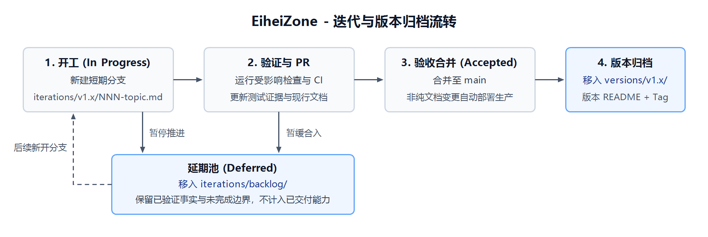

# 当前开发流程

> 当前基线：`v1.5.1`（最后更新：2026-10-30）

本文档说明日常迭代、分支、测试、归档和发版方式。V1 初期的六阶段流程归档在 [`versions/v1/00b_v1_development_process.md`](versions/v1/00b_v1_development_process.md)，不再作为日常迭代模板。

## 1. 迭代流转与状态

图表文件：[`_附件_/iteration-workflow.puml`](_附件_/iteration-workflow.puml)（PlantUML）、[`_附件_/iteration-workflow.svg`](_附件_/iteration-workflow.svg)（SVG 矢量，可直接用 draw.io 编辑）与 [`_附件_/iteration-workflow.png`](_附件_/iteration-workflow.png)（PNG）。

一次功能或一组相关变更在 `docs/iterations/v1.x/` 中建立一份迭代文档（模板见 [`iterations/_template.md`](iterations/_template.md)），只使用 3 种状态：

| 状态 | 含义 |
| --- | --- |
| `In Progress` | 已从最新 `main` 创建短期分支，明确目标、范围、不做事项和验收标准，正在实施或验证 |
| `Accepted` | 受影响检查与业务验收通过，实际测试结果与遗留风险已记录；版本收口时移入 `docs/versions/v1.x/` |
| `Deferred` | 暂停推进并移入 `docs/iterations/backlog/`，保留已验证事实与未完成边界，不计入已交付能力 |

小错字或不改变外部行为的局部维护，直接记录在提交和 PR 中，不必新建迭代文档。

做计划时，如果方案会影响多个模块、部署、安全或数据边界，或者以后的迭代还得重做这个决定，就按 [`adr/README.md`](adr/README.md) 新增 ADR，并从迭代文档链接。只留在当前功能内部的实现取舍，写在迭代文档里即可。

## 2. 分支与 Pull Request

1. 从最新 `main` 创建一条短期分支：`<type>/v<version>-<iteration-id>-<kebab-topic>`，允许类型为 `feat`、`fix`、`docs`、`test`、`ops`、`refactor`（如 `docs/v1.5.1-001-documentation-standardization`）。
2. 同一功能后续修改留在该分支，代码、测试、Migration 和受影响现行文档同步更新，不回填已冻结的旧版本文档。
3. PR 标题使用 `<type>(<scope>): 
 [v<version>-<id>]`，正文链接迭代文档并说明范围、数据/部署影响、验证结果与遗留风险。
4. `Backend`、`Frontend`、`Deployment artifacts` 三项 required checks 全部通过后才可合并。

合并到 `main` 后，运行时代码、部署脚本和会进入站点的静态资源才会再次触发 `main` CI 与生产自动部署。只包含 `docs/**`、根目录三份 README、`AGENTS.md`、`.github/pull_request_template.md` 或 `.github/workflows/**` 的 push 在 PR 阶段完成检查，合并后不触发生产部署。依据见 [ADR-0002](adr/0002-skip-deploy-for-non-runtime-files.md)。

## 3. 版本收口与发版

当同一目标版本的已完成迭代全部 `Accepted` 后：

1. 将已完成迭代从 `docs/iterations/v1.x/` 移入 `docs/versions/v1.x/`，未完成项移入 `docs/iterations/backlog/`（标为 `Deferred`）；
2. 编写 `docs/versions/v1.x/README.md`，汇总完成项、Migration、验证证据和未包含能力；
3. 更新 `docs/README.md` 与 `docs/iterations/README.md` 入口链接，不保留空壳旧版本目录；
4. 归档 PR 合并、生产部署（如涉及代码）和健康检查通过后，在对应 `main` 提交上创建 annotated tag（如 `v1.5.0`）和 GitHub Release。

## 4. 变更同步清单

| 变更内容 | 同步更新位置 |
| --- | --- |
| 新功能或缺陷修复 | 代码、回归测试、当次迭代文档或 PR 验证记录 |
| 数据库结构变化 | Alembic Migration、专用测试库升级验证记录 |
| 系统组件或数据契约变化 | [`architecture.md`](architecture.md) |
| 部署、回滚、备份或清理方式变化 | [`operations.md`](operations.md) |
| 影响多个模块、部署、安全或数据边界，或以后还会重做的技术选择 | [`adr/`](adr/README.md) |
