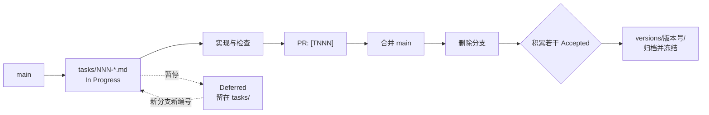

# 分支与任务规范

> 适用：所有新任务。`versions/` 中的历史归档保持冻结，不按本规范追溯重编。

本文件是分支命名、任务编号与发版封箱的唯一来源。`AGENTS.md`、`docs/standards/development-process.md` 与 PR 模板只保留摘要或引用，不重复定义。

## 1. 分支命名

格式：

```text
<type>/<id>-<short-description>
```

| 部分 | 规则 |
| --- | --- |
| `type` | 受控类型：`feat`、`fix`、`docs`、`refactor`、`chore`、`exp` |
| `id` | 任务编号的数字部分，至少三位，与 `TNNN` 一致 |
| `short-description` | 全小写英文 kebab-case，只说明这次做什么 |

- 严格全小写、短横线连接；不得使用大写、下划线、空格或中文。
- 分支名严禁带版本号（如 `v1.5`），版本只出现在 `versions/` 目录。
- 示例：`feat/002-ast-detectors`、`fix/003-nav-padding`、`refactor/003-doc-governance`。

## 2. 分支生命周期

1. 从最新 `main` 切出，一条任务对应一条短期分支。
2. 同一任务的后续修改留在同一条分支，不为同一功能另开分支。
3. PR 合入 `main` 后立即删除该分支（本地和远端），不再复用。
4. 继续历史延期项时，按新编号新建分支，不恢复已删除的旧分支。

## 3. 编号与任务文件

- 编号全局单调自增：`T001`、`T002`、`T003`……跨版本绝不重置。
- 任务文档路径为 `docs/tasks/NNN-kebab-topic.md`，frontmatter 的 `id` 为 `TNNN`。
- 文件名、frontmatter `id` 与分支名中的数字必须一致。
- 正文、提交说明和 PR 中引用任务时统一写 `TNNN`（如 `T001`）。
- 历史归档中的旧版本编号（如 001、006）不追溯改写，也不占用新序列。
- 当前序列：`T001` 为 v1.5 文档标准化（Accepted，仍在 `tasks/` 等待封箱），`T002` 为原 `006` 延期项，`T003` 为本次文档重构；下一条从 `T004` 继续。新编号取已有 `T` 编号最大值加一，冻结归档中的旧版本编号不参与计算。

## 4. 任务生命周期

任务文档使用 YAML frontmatter，字段契约见 `docs/schemas/task-frontmatter.schema.json`，模板见 `docs/tasks/_template.md`。

| 状态 | 含义 | 存放位置 |
| --- | --- | --- |
| `In Progress` | 已建分支，正在实现或验证 | `docs/tasks/` |
| `Accepted` | 检查与验收通过，等待发版封箱 | `docs/tasks/` |
| `Deferred` | 暂停推进；保留已验证事实与未完成边界 | `docs/tasks/` |

- 活跃与延期任务都放在 `docs/tasks/`，不再建立 `iterations/`、`backlog/` 等平行目录。
- 延期任务的 frontmatter 写 `branch: null`。
- 不改变外部行为的小错字或局部维护，可只写在提交说明与 PR 中，不必新建任务文档。
- 任务文档只记录真实结果：检查结果使用 `PASS`、`FAIL`、`未验证`，不把计划写成结果。
- 有多种真实实现方式时，用短文或简表写下取舍；不要求加权决策矩阵。

## 5. Pull Request

- 标题：`<type>(<scope>): <summary> [TNNN]`，例如 `docs(docs): restructure docs and branch rules [T003]`。
- 正文写明任务编号和任务文档路径，说明范围、数据/部署影响、检查结果与遗留风险。
- 涉及多个模块、部署、安全或数据边界，或以后还会重做的技术选择，在任务文档的「方案与技术影响」中写清楚取舍和影响范围。

## 6. 发版封箱

当积累若干 `Accepted` 任务、需要发版时：

1. 新建 `docs/versions/<版本号>/`。
2. 只把 `Accepted` 任务文档移入该目录；`In Progress` 和 `Deferred` 任务留在 `docs/tasks/`。
3. 写 `docs/versions/<版本号>/README.md`，汇总版本内容与验证证据。
4. 更新 `docs/README.md` 与 `docs/versions/README.md` 入口，不保留空壳目录。
5. 归档后该版本物理冻结：不重写正文，只允许修复失效的相对链接。
6. 不创建 `registry.yaml`、任务清单或任何与目录内容重复的索引文件。


